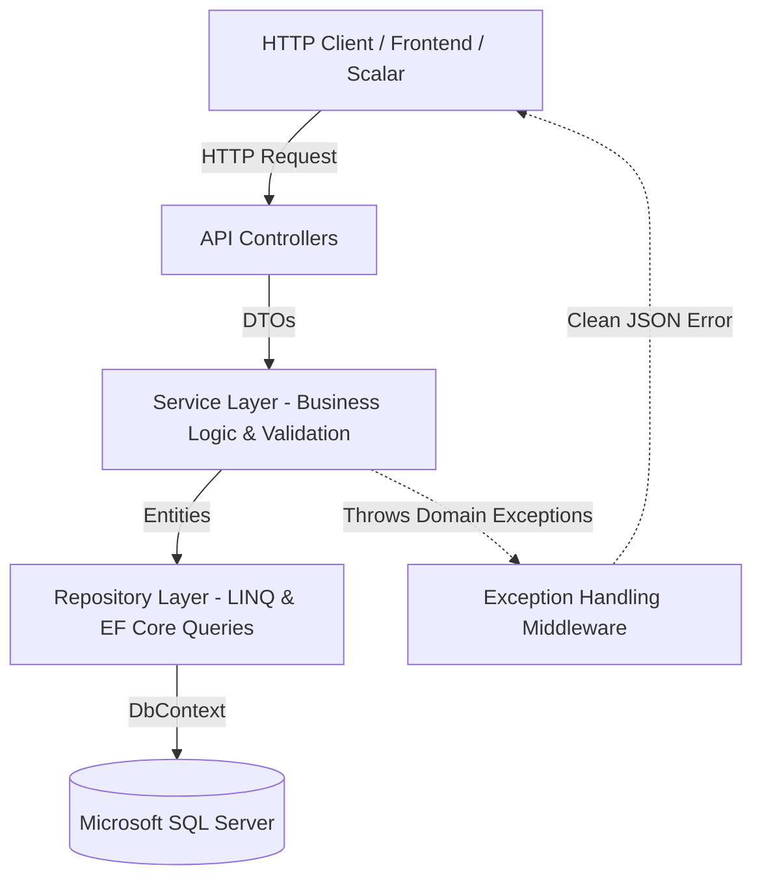
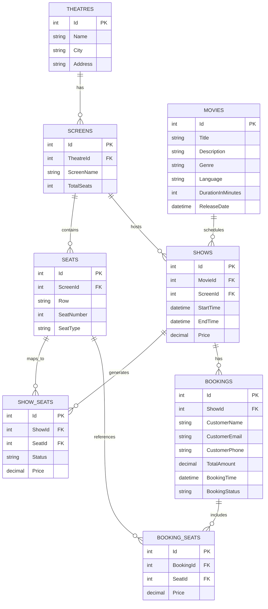

# Movie Ticket Booking System - ASP.NET Core Web API (.NET 10)

A production-ready, beginner-friendly **Movie Ticket Booking System Web API** built with **ASP.NET Core (.NET 10)**, **C#**, **Entity Framework Core 10**, and **Microsoft SQL Server**.

This project implements a strict, enterprise-standard **N-Tier Architecture**:
$$\text{Controller} \longrightarrow \text{Service (Business Logic)} \longrightarrow \text{Repository (Data Access)} \longrightarrow \text{ApplicationDbContext (EF Core)}$$

---

## 🌟 Key Features

1. **Movie Management**: Full CRUD operations and multi-parameter search (by title, genre, and language).
2. **Theatres & Screens**: Multi-theatre and multi-screen hierarchy with cascade and restriction integrity.
3. **Seat Management & Bulk Creation**: Configure screen seating plans (Classic, Premium, VIP) with bulk creation and duplicate detection.
4. **Show Scheduling & Automated Inventory**:
   - Time window validation (`EndTime > StartTime`).
   - Overlap collision detection (prevents booking the same screen for overlapping shows).
   - Automatic generation of `ShowSeats` inventory upon show creation.
5. **Real-Time Seat Availability**: Check available, reserved, and booked seats along with a live summary count.
6. **Atomic Ticket Booking**:
   - Multi-seat selection per transaction.
   - Dynamic price calculation on the backend (prevents client-side tampering).
   - Concurrency & double-booking prevention using SQL Server atomic transactions.
7. **Booking Cancellation**: Cancels existing reservations and atomically frees the associated seats back to `"Available"` state while keeping audit trails.
8. **Centralized Exception Handling Middleware**: Standardized RFC 7807 problem details response for bad requests, validation errors, not-found exceptions, and unhandled server errors.
9. **Interactive API Documentation**: Modern, beautiful API documentation with **Scalar** OpenAPI UI.

---

## 🛠️ Technology Stack

| Layer / Tool | Technology |
|---|---|
| **Framework** | ASP.NET Core Web API (.NET 10) |
| **Language** | C# 13 / .NET 10 |
| **ORM** | Entity Framework Core 10 (Code-First) |
| **Database** | Microsoft SQL Server (Local / SQLEXPRESS) |
| **API Documentation** | Scalar (`Scalar.AspNetCore` 2.x) |
| **Architecture** | Controller $\to$ Service $\to$ Repository $\to$ DbContext |
| **Validation** | Clean defensive checks in Services & Controllers |
| **Error Handling** | Custom Centralized Middleware (`ExceptionHandlingMiddleware`) |

---

## 🏗️ Architecture & Layer Responsibility



- **Controllers**: Handle HTTP routing, status codes, and model binding. Zero business logic.
- **DTOs (Data Transfer Objects)**: Separate network contracts from internal database entities. Manual mapping is used for complete transparency and performance.
- **Services**: Enforce all domain rules, cross-entity validations, price computations, and transaction coordination.
- **Repositories**: Pure data access abstraction using LINQ and EF Core. No business rules.
- **ApplicationDbContext**: Configures table schemas, relationships, composite unique indexes, and delete cascade behaviors via Fluent API.
- **ExceptionHandlingMiddleware**: Catches all thrown exceptions globally and translates them into uniform JSON responses.

---

## 🗄️ Database Schema & Relationships



### Table Integrity & Key Constraints
- **Seats**: Composite Unique Index on `(ScreenId, SeatNumber)` — prevents duplicate seat numbers in a screen.
- **ShowSeats**: Composite Unique Index on `(ShowId, SeatId)` — guarantees 1:1 inventory mapping per show.
- **BookingSeats**: Composite Unique Index on `(BookingId, SeatId)` — prevents duplicate seat references in the same booking.
- **Prices & Money**: Configured as `decimal(10, 2)`.
- **Referential Integrity**: Delete behavior carefully set (`Cascade` for child collections like `Show -> ShowSeats`, `Restrict` on parents to prevent accidental deletion cycles).

---

## 📁 Project Folder Structure

```
Movie Ticket Booking System/
│
├── MovieTicketBooking.slnx           # .NET 10 Solution file
├── README.md                         # Project documentation
│
└── MovieTicketBooking/               # Web API Project
    ├── Controllers/                  # API Controllers
    │   ├── MoviesController.cs
    │   ├── TheatresController.cs
    │   ├── ScreensController.cs
    │   ├── SeatsController.cs
    │   ├── ShowsController.cs
    │   └── BookingsController.cs
    │
    ├── Services/                     # Business Logic Layer
    │   ├── Interfaces/
    │   │   ├── IMovieService.cs
    │   │   ├── ITheatreService.cs
    │   │   ├── IScreenService.cs
    │   │   ├── ISeatService.cs
    │   │   ├── IShowService.cs
    │   │   └── IBookingService.cs
    │   ├── MovieService.cs
    │   ├── TheatreService.cs
    │   ├── ScreenService.cs
    │   ├── SeatService.cs
    │   ├── ShowService.cs
    │   └── BookingService.cs
    │
    ├── Repositories/                 # Data Access Layer
    │   ├── Interfaces/
    │   │   ├── IMovieRepository.cs
    │   │   ├── ITheatreRepository.cs
    │   │   ├── IScreenRepository.cs
    │   │   ├── ISeatRepository.cs
    │   │   ├── IShowRepository.cs
    │   │   └── IBookingRepository.cs
    │   ├── MovieRepository.cs
    │   ├── TheatreRepository.cs
    │   ├── ScreenRepository.cs
    │   ├── SeatRepository.cs
    │   ├── ShowRepository.cs
    │   └── BookingRepository.cs
    │
    ├── Models/                       # Database Entities (EF Core)
    │   ├── Movie.cs
    │   ├── Theatre.cs
    │   ├── Screen.cs
    │   ├── Seat.cs
    │   ├── Show.cs
    │   ├── ShowSeat.cs
    │   ├── Booking.cs
    │   └── BookingSeat.cs
    │
    ├── DTOs/                         # Request / Response Contracts
    │   ├── Movies/
    │   ├── Theatres/
    │   ├── Screens/
    │   ├── Seats/
    │   ├── Shows/
    │   └── Bookings/
    │
    ├── Data/                         # EF Core DbContext & Configurations
    │   └── ApplicationDbContext.cs
    │
    ├── Middleware/                   # Global Middleware
    │   └── ExceptionHandlingMiddleware.cs
    │
    ├── Migrations/                   # EF Core Code-First Migrations
    ├── appsettings.json              # Connection strings and config
    └── Program.cs                    # Application startup & DI registration
```

---

## 🚀 Getting Started

### 1. Prerequisites
- **.NET 10 SDK** (or .NET 9/8 with minimal adjustments)
- **Microsoft SQL Server** (Local instance, SQLEXPRESS, or Azure SQL)
- **Visual Studio 2022** (v17.12+ for .NET 10) OR **VS Code** with C# Dev Kit

### 2. Database Configuration
Open `MovieTicketBooking/appsettings.json` and configure your SQL Server connection string:
```json
{
  "ConnectionStrings": {
    "DefaultConnection": "Server=.\\SQLEXPRESS;Database=MovieTicketBookingDB;Trusted_Connection=True;TrustServerCertificate=True;"
  }
}
```

### 3. Apply EF Core Migrations
Open PowerShell or Command Prompt in the project folder and run:
```bash
cd "d:\Movie Ticket Booking System\MovieTicketBooking"
dotnet ef database update
```
This automatically connects to SQL Server and creates `MovieTicketBookingDB` with all tables, indexes, and foreign keys.

### 4. Run the Application
```bash
dotnet run
```
The API will launch and be available at:
- **HTTP**: `http://localhost:5020`
- **HTTPS**: `https://localhost:7280`
- **Scalar Interactive Documentation**: `http://localhost:5020/scalar/v1`

---

## 📖 API Endpoints Catalog

### 🎬 Movies (`/api/movies`)
| Method | Endpoint | Description |
|---|---|---|
| `GET` | `/api/movies` | Get all active movies |
| `GET` | `/api/movies/{id}` | Get movie by ID |
| `GET` | `/api/movies/search?title=...&genre=...&language=...` | Search movies |
| `POST` | `/api/movies` | Create a new movie |
| `PUT` | `/api/movies/{id}` | Update movie details |
| `DELETE` | `/api/movies/{id}` | Delete a movie |

### 🏛️ Theatres (`/api/theatres`)
| Method | Endpoint | Description |
|---|---|---|
| `GET` | `/api/theatres` | Get all theatres |
| `GET` | `/api/theatres/{id}` | Get theatre by ID (includes screens) |
| `POST` | `/api/theatres` | Create a theatre |
| `PUT` | `/api/theatres/{id}` | Update a theatre |
| `DELETE` | `/api/theatres/{id}` | Delete a theatre |

### 🖥️ Screens (`/api/screens`)
| Method | Endpoint | Description |
|---|---|---|
| `GET` | `/api/screens/theatre/{theatreId}` | Get all screens for a theatre |
| `GET` | `/api/screens/{id}` | Get screen by ID |
| `POST` | `/api/screens` | Create a screen |
| `PUT` | `/api/screens/{id}` | Update a screen |
| `DELETE` | `/api/screens/{id}` | Delete a screen |

### 💺 Seats (`/api/seats`)
| Method | Endpoint | Description |
|---|---|---|
| `GET` | `/api/seats/screen/{screenId}` | Get all seats in a screen |
| `POST` | `/api/seats` | Add a single seat |
| `POST` | `/api/seats/bulk` | Bulk create seats for a screen |
| `DELETE` | `/api/seats/{id}` | Delete a seat |

### 🎟️ Shows (`/api/shows`)
| Method | Endpoint | Description |
|---|---|---|
| `GET` | `/api/shows` | Get all shows |
| `GET` | `/api/shows/{id}` | Get show by ID (includes Movie, Theatre, Screen) |
| `GET` | `/api/shows/movie/{movieId}` | Get shows for a movie |
| `GET` | `/api/shows/screen/{screenId}` | Get shows for a screen |
| `POST` | `/api/shows` | Schedule a show (validates overlap + auto-generates seats) |
| `DELETE` | `/api/shows/{id}` | Delete a show |

### 📊 Seat Availability (`/api/shows/{id}`)
| Method | Endpoint | Description |
|---|---|---|
| `GET` | `/api/shows/{id}/availability` | Get availability summary (`Total`, `Available`, `Booked`) |
| `GET` | `/api/shows/{id}/seats` | Get all show seats (supports optional `?status=Available`) |

### 🧾 Bookings & Cancellations (`/api/bookings`)
| Method | Endpoint | Description |
|---|---|---|
| `POST` | `/api/bookings` | Book seats atomically (prevents double-booking) |
| `GET` | `/api/bookings/{id}` | Get booking details with seats & movie info |
| `GET` | `/api/bookings/customer/{email}` | Get all bookings by customer email |
| `POST` | `/api/bookings/{id}/cancel` | Cancel booking & release seats atomically |

---

## 🧪 Sample Request & Response

### 1. Create a Booking (`POST /api/bookings`)
**Request Body**:
```json
{
  "showId": 1,
  "customerName": "Alice Johnson",
  "customerEmail": "alice@example.com",
  "customerPhone": "9876543210",
  "seatIds": [1, 2]
}
```

**Response (`201 Created`)**:
```json
{
  "id": 1,
  "showId": 1,
  "movieTitle": "Inception: Remastered",
  "theatreName": "PVR Cinemas",
  "screenName": "Screen 1 - IMAX",
  "customerName": "Alice Johnson",
  "customerEmail": "alice@example.com",
  "customerPhone": "9876543210",
  "totalAmount": 700.00,
  "bookingTime": "2026-11-01T10:00:00Z",
  "bookingStatus": "Confirmed",
  "seats": [
    {
      "seatId": 1,
      "row": "A",
      "seatNumber": 1,
      "seatType": "Classic",
      "price": 350.00
    },
    {
      "seatId": 2,
      "row": "A",
      "seatNumber": 2,
      "seatType": "Classic",
      "price": 350.00
    }
  ]
}
```

### 2. Cancel a Booking (`POST /api/bookings/1/cancel`)
**Response (`200 OK`)**:
```json
{
  "id": 1,
  "bookingStatus": "Cancelled",
  "totalAmount": 700.00,
  "seats": [
    { "seatId": 1, "row": "A", "seatNumber": 1 },
    { "seatId": 2, "row": "A", "seatNumber": 2 }
  ]
}
```

---

## 🛡️ Centralized Error Handling

All uncaught exceptions and domain validation errors return a clean, RFC-compliant JSON response:

```json
{
  "error": "One or more selected seats are already booked for this show.",
  "statusCode": 400,
  "timestamp": "2026-10-31T21:49:15.123Z"
}
```

---

## 📜 License
This project is open-source and intended for educational and production use.
